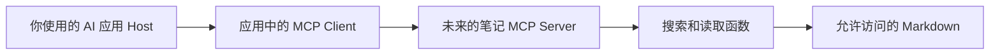

# MCP 与工具接入

[卡片目录](README.md) · [第四阶段课程](../20-课程笔记/第四阶段-工具调用与Agent课程及实践顺序.md)

## 一句话解释

**MCP 是 AI 应用与外部工具、资料服务之间的一套连接规则。**可以把它理解为双方约定的接口语言：怎样发现能力、提交请求、收到结果。它本身不是模型，也不是知识库。

## 为什么需要它

当前 Python 脚本可以直接调用搜索函数，已经足够学习工具使用。以后如果多个 AI 应用都想使用同一套笔记搜索功能，各写一套接口会重复劳动；支持 MCP 的服务可以提供共同接入方式。

连接规则只解决连接层面的协作，不能保证资料质量、模型能力或权限正确。先知道工具输入输出，再考虑是否需要包装成服务，学习负担会小很多。

## 用 MindVault 走一遍

假设未来把 MindVault 搜索做成 MCP 服务，关系可以这样画。下图是设计示意，当前没有部署这条链路：

Host 是用户面对的 AI 应用，协调模型和工具使用；Client 是其中负责与服务通信的组件；Server 提供工具或资料。Server 可以是本地程序，也可以是远端服务，“服务”不必等于买一台云服务器。

未来一次调用可能是：应用发现服务提供 search_notes → 把适配后的工具说明交给模型 → 模型提出搜索请求 → 应用通过 Client 调用 Server → Server 执行搜索并返回 → 应用把结果放进模型会话。

本地函数、MCP 通信、模型工具协议是不同层。当前 `{"ok":true,"data":...}` 是我们函数的结果结构；做 MCP 时还需按协议包装返回内容，不能只改工具名字就声称完成接入。

## 每一步的输入输出

| 步骤 | 输入 | 输出与责任 |
| --- | --- | --- |
| 建立可用连接 | 兼容的应用与服务配置 | 客户端可与服务通信 |
| 发现能力 | 服务提供的工具定义 | 应用可见的名称、描述、参数 |
| 适配模型 | 工具说明与任务 | 模型提出调用 |
| 执行请求 | 工具名、参数、权限 | Server 返回工具结果或错误 |
| 回到任务 | 适配后的结果 | 模型继续或结束 |

具体版本、连接过程与传输配置取决于双方实现；这里先理解职责，不照抄某个历史配置当作已验证安装步骤。

## 常见疑问

**MCP 与 Function Calling 是同一件事吗？**不是。Function Calling 是模型如何表达工具请求，MCP 是应用如何接入外部能力。应用可用 MCP 获取工具再交给模型，也可完全不用 MCP、直接执行本地函数。

**LangGraph 和 MCP 谁替代谁？**两者职责不同。LangGraph 组织状态和流程，MCP 提供接入协议；同一应用可以同时使用，也可以都不用。

**MCP 只能提供工具吗？**还可以提供资源和提示模板等能力。资源是可读取的数据，提示模板是复用的交互内容；本阶段先关注搜索与读取工具即可。

**安装 Server 就能让 Obsidian 自动会问答吗？**不能。还需要支持对应连接的应用、模型配置、工具适配和资料权限；当前 MindVault 没有安装聊天插件或运行 MCP 服务。

**远端服务会自动安全过滤我的资料吗？**不能这样假设。应明确返回什么、发给谁、允许哪些操作。协议不能替代权限和数据范围设计。

## 小练习与自测

**题目：**把函数重命名为 mcp_search，是否算接入 MCP？

**参考答案：**不算。需要真实实现兼容的通信、能力发现和调用结果处理，并通过客户端验证。

**设计练习：**为未来笔记 Server 写下两个工具、输入字段、允许资料目录、返回格式和错误处理。再指出 Host、Client、Server 分别在哪里；不需要先安装依赖。

### 动手记录

- [ ] 画出“AI 应用 → MCP Client → 笔记 Server → 选定资料”的关系。
- [ ] 写出哪些资料允许返回、哪些工具只读、发生失败时返回什么。

## 本库实现与实践入口

先完成实践一和二，再做实践三的连接设计。`langgraph_workflow.py` 是单独的可选固定流程示例，不是 MCP Server。跨应用复用确有需求后，再选择兼容的客户端和 SDK，单独验证接入。

[项目入口](../30-项目实践/04-工具调用与学习Agent/README.md) · [实现代码](../30-项目实践/04-工具调用与学习Agent/study_agent.py) · [实践一：工具与固定流程](../30-项目实践/04-工具调用与学习Agent/实践一-两个工具与固定工作流.md) · [实践二：循环与调用](../30-项目实践/04-工具调用与学习Agent/实践二-Agent循环与真实工具调用.md) · [实践三：框架与MCP](../30-项目实践/04-工具调用与学习Agent/实践三-LangGraph与MCP接入设计.md) · [评估模板](../30-项目实践/04-工具调用与学习Agent/评估记录模板.md)

阅读和离线练习不需要 API Key；live 才调用外部模型并可能产生费用。示例原文见[API 配置笔记](../30-项目实践/03-RAG知识库问答/examples/notes/01-API配置.md)。

## 来源与延伸阅读

[MCP 官方架构](https://modelcontextprotocol.io/docs/learn/architecture)：Host、Client、Server 与能力模型。核查时该地址重定向到 2026-07-28 版本；实际实现要核对双方协议兼容性。本页拓扑和未来接入流程为教学设计，并非运行报告。

核查日期：2026-10-29。外部资料用于核对概念与协议，核心解释已写在本页。生活类比、表格与 MindVault 示例为本库整理；脚本演示不代表真实模型效果实测。

## 相关笔记与下一步

上一张：[Agent记忆与上下文](Agent记忆与上下文.md) · 下一张：[评估集与数据划分](评估集与数据划分.md)

到达本阶段阅读末尾后，先选择下面的实践并记录验收结果，再继续下一阶段；选修按目标决定。

[本阶段阅读顺序](../20-课程笔记/第四阶段-工具调用与Agent课程及实践顺序.md) · [本阶段实践](../30-项目实践/04-工具调用与学习Agent/README.md)

相关回看：[下一张：Agent与固定工作流](Agent与固定工作流.md) · [RAG 检索增强生成](RAG检索增强生成.md) · [上下文](上下文.md)
