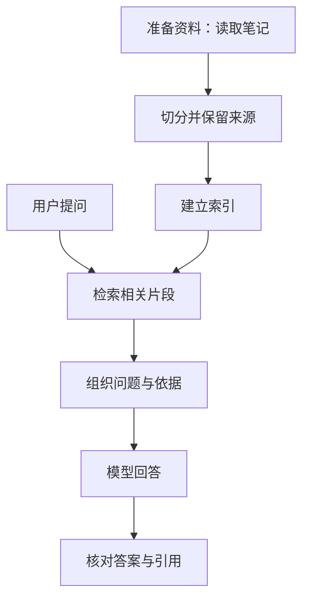

# RAG 检索增强生成

[第三阶段阅读顺序](../20-课程笔记/第三阶段-RAG课程与实践顺序.md) · [项目 03](../30-项目实践/03-RAG知识库问答/README.md)

## 一句话解释

**RAG 是让程序先找资料，再让模型根据找到的资料回答。**英文 Retrieval-Augmented Generation 可以拆成“检索、增强、生成”：检索找材料；增强把材料补进本次输入；生成把材料组织成回答。

可以把它想成开卷考试：笔记是教材，检索程序负责翻页，模型负责阅读和作答。类比的边界是：程序可能翻错页，模型也可能读错，因此还要检查结果。

## 为什么需要它

你问“我上周在 MindVault 记录的 RAG 实验，哪种切分效果更好？”模型一般无法仅凭训练时学到的知识知道你的私人实验。把笔记存进电脑，也不会自动让模型看到它。

资料很少时，可以自己复制相关段落到问题后面；资料多时，逐篇寻找很费事，全部塞进一次请求又会受到上下文容量、费用和干扰信息的影响。RAG 把“寻找相关材料”这一步交给程序。

这里的“增强”主要改变本次提供给模型的上下文，不是重新训练模型。修改原始笔记后，要让检索系统使用新内容；普通 RAG 不会因此自动更新模型内部参数。

## 用 MindVault 走一遍

问题：**“API 密钥应该放在哪里，能写进 Git 吗？”**

项目已有的[API 配置示例](../30-项目实践/03-RAG知识库问答/examples/notes/01-API配置.md)包含两句依据：

> API 密钥用于认证调用方，建议放在本地环境变量中。
> 不要把真实 API 密钥写进 Markdown、代码或 Git 提交。

先准备资料：程序读取这份 Markdown，把长文拆成小片段，并保存片段来自哪个文件、哪几行。随后建立索引，也就是一份方便查找的资料组织结果。

提问时：程序用问题搜索索引，选出相关片段，把“问题＋片段＋回答要求”放进模型请求。模型才有机会回答：“建议放在本地环境变量中，不要写进 Git”，并给出来源。

上面是依据原文写出的教学答案，不是本次真实模型调用的结果。真正运行时，应检查模型是否正确保留了“不要提交密钥”这个条件。

## 每一步的输入输出

| 步骤 | 输入 | 输出 | 新手先检查什么 |
| --- | --- | --- | --- |
| 加载 | 选定目录里的 Markdown | 文本及文件信息 | 正文是否完整、文件是否选对 |
| 切分 | 一篇较长文本 | 若干小片段 | 条件与结论是否被拆开 |
| 建索引 | 片段、来源及检索需要的信息 | 可保存、可查询的索引 | 能否从片段回到原文 |
| 检索 | 问题和索引 | 排好序的候选片段 | 是否真包含回答所需证据 |
| 组织上下文 | 问题、候选、任务要求 | 一次模型请求 | 模型实际看到了哪些材料 |
| 生成与核对 | 请求和模型返回结果 | 回答、引用、问题记录 | 引文是否支持每个关键结论 |

索引准备通常可以复用；每次提问都要重新寻找与当前问题相关的片段。资料变化时则要更新索引。

## 常见疑问

**RAG 必须用向量数据库吗？** 不必。找到资料可以使用关键词匹配、向量相似度等方法。先用几篇笔记验证流程，再决定存储和检索工具。

**有 RAG 就不会幻觉了吗？** 仍可能出错。资料本身可能过时，检索可能漏掉关键句，模型也可能把“不可以”读成“可以”。要分别检查资料、检索和回答。

**我现在已经有自动问答助手了吗？** 当前有可以运行的教学脚本和步骤。打开 Obsidian 不会自动运行这些脚本；完成索引、选择运行方式后，才能观察相应结果。

**关键词搜索也叫完整 RAG 吗？** 单独搜索完成的是检索部分。把找到的证据交给生成模型，才走完这里讨论的检索增强生成链路。

## 小练习与自测

先不运行代码，自己给上述问题写出“要找的证据”和“不能凭空补充的信息”，再解释模型为什么必须实际收到片段。

**自测：改了笔记，模型为什么还可能答旧内容？**

参考答案：可能仍用了旧索引，也可能新片段没有被检索出来，或者答案复用了旧缓存。先查看本次实际提供的上下文，再定位是哪一步没更新。

### 动手记录

- [ ] 手工找一篇笔记，把问题和其中一段一起交给模型，再检查回答。
- [ ] 画出本项目中哪些步骤离线完成，哪一步可能调用外部 API。

## 本库实现与实践入口

项目默认以关键词方式检索；`extractive` 返回原文摘录，`preview` 展示请求，这两种方式都不调用生成模型。选择 `live` 才发送问题和选中片段进行真实生成。向量检索是单独的选修步骤。

先做[实践一：加载、切分与关键词检索](../30-项目实践/03-RAG知识库问答/实践一-加载切分与关键词检索.md)，再做[实践二：带引用问答与评估](../30-项目实践/03-RAG知识库问答/实践二-带引用问答与评估.md)。

## 来源与延伸阅读

正文为本库教学讲解，例子来自本库示例文件。概念核查于 2026-10-29：[LlamaIndex RAG 入门](https://developers.llamaindex.ai/python/framework/understanding/rag/)用于核对整体流程；[Datawhale llm-universe](https://github.com/datawhalechina/llm-universe)第 3–4 章用于继续学习知识库与 RAG 应用。先完成本页即可开始基础练习。

## 相关笔记与下一步

上一张：[Token用量与调用成本](Token用量与调用成本.md) · 下一张：[文档加载与元数据](文档加载与元数据.md)

[本阶段阅读顺序](../20-课程笔记/第三阶段-RAG课程与实践顺序.md) · [本阶段实践](../30-项目实践/03-RAG知识库问答/README.md)

相关回看：[上下文](上下文.md) · [幻觉](幻觉.md)
