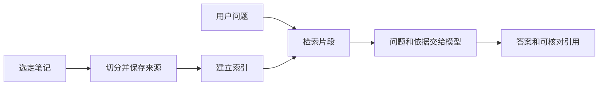

# RAG 检索增强生成

[知识卡片目录](README.md) · [第三阶段课程](../20-课程笔记/第三阶段-RAG课程与实践顺序.md)

## 一句话解释

**RAG 是先从资料里找依据，再把问题和依据一起交给模型回答。**像开卷考试：先翻到相关页，再组织答案。它通常不会因此更新模型参数。

## 用 MindVault 举例

问“API 密钥放哪里？”→ 找到密钥笔记 → 取出环境变量那一段 → 模型据此回答 → 附笔记路径和原文片段。文档加载、索引、检索和生成可以分别检查。[流程依据：LlamaIndex RAG](https://developers.llamaindex.ai/python/framework/understanding/rag/)

## 容易误解的地方

- 笔记在硬盘上，不代表模型已经看到了；只有本次传入的片段才进入这次上下文。
- 搜到相似文字不等于已有答案；模型也可能曲解正确材料。
- RAG 可以减少无依据回答，但不能保证消除幻觉。分别检查检索与答案。

## 小练习与自测

- [ ] 手工找一篇笔记，把问题和其中一段一起交给模型，再检查回答。
- [ ] 画出本项目中哪些步骤离线完成，哪一步可能调用外部 API。

**问题：**改了笔记，模型为什么还可能答旧内容？

**参考要点：**索引可能仍是旧版，或者本次检索没找到新片段；先看实际提供的上下文。

## 来源与相关笔记

[Datawhale llm-universe](https://github.com/datawhalechina/llm-universe)，第一部分第 3–4 章；[LlamaIndex RAG](https://developers.llamaindex.ai/python/framework/understanding/rag/)。核查：2026-10-23。例子与练习为本库设计。

[上下文](上下文.md) · [幻觉](幻觉.md) · [文档加载与元数据](文档加载与元数据.md)
