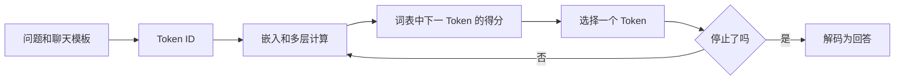

# Transformer与自回归生成

[卡片目录](README.md) · [进阶课程](../20-课程笔记/进阶阶段-模型原理本地部署与微调.md)

## 一句话解释

**Transformer 是由注意力等模块构成的序列模型结构；自回归生成根据已有 Token 预测下一个，再把选出的 Token 接回去继续。**像接龙，每一步都依据已有内容决定下一步。

## 为什么需要它

聊天界面看起来一次给出整段回答，内部通常经过许多次下一 Token 选择。理解这条过程，才能解释输出上限、停止标记、采样和缓存为什么影响结果。

Transformer 是结构，自回归是生成方式，不应当作同一个概念。原始论文有编码器和解码器，常见生成式 LLM 使用仅解码器结构。

## 用 MindVault 走一遍

以“请解释 Token”为例，简化流程如下。词与编号仅作示意，不是真实分词或模型得分：

循环时，新 Token 要接到已有前缀；实际实现可用 KV Cache 复用历史计算，不必每步从零处理全部内容。

| 层次 | 做什么 | 先记住 |
| --- | --- | --- |
| 嵌入与位置信息 | 把编号转成可处理表示并体现顺序 | Token ID 本身不是意义大小 |
| 注意力 | 汇总相关位置信息 | 因果模型不能偷看未来 |
| 前馈网络 | 对位置表示做非线性变换 | 一层不只有注意力 |
| 残差与归一化 | 组织和稳定信息流 | 具体顺序依架构而定 |
| 输出层 | 给词表各候选打分 | 分数叫 logits |

假设下一步概率是 A=0.6、B=0.3、C=0.1。贪心选择 A；采样按分布抽取，不保证每次选 A。常见 temperature 调整分布尖锐程度，不是“事实可信度”。EOS 等停止标记、输出数量上限和其他规则可以结束生成。

## 每一步的输入输出

| 步骤 | 输入 | 输出 |
| --- | --- | --- |
| 编码 | 模板化文本 | Token 序列 |
| 前向计算 | 前缀与固定权重 | 下一个 Token 的 logits |
| 选择 | 得分与解码设置 | 一个新 Token |
| 延长前缀 | 旧前缀、新 Token、缓存 | 下一步输入状态 |
| 停止解码 | 结束条件或长度上限 | 完整或被截断的文字 |

一轮聊天 API 请求可能包含很多生成步；不要把 API 次数等同于 Token 预测次数。

## 常见疑问

**推理会顺便训练模型吗？**普通推理不更新权重。变化的是输入、生成序列和计算缓存；学习参数需要单独训练流程。

**贪心就一定正确吗？**它只选当前分数最高的候选，不保证事实正确，也不保证整个回答最优。

**流式输出就是不同的模型吗？**流式主要改变如何逐步把结果交给客户端，不等于更改训练方式。

**实践一是否已经实现 Transformer？**没有，只展示一个注意力运算和损失更新，缺少完整架构、词表、训练权重等。

## 小练习与自测

**题目：**把输出上限设很小，回答中途结束，应先怀疑模型不会还是检查停止原因？

**参考答案：**先查上限与停止原因，区分截断和内容能力问题。

**练习：**画出问题从文本到下一个 Token 的过程，标明哪一步属于 Tokenizer，哪一步使用权重，哪一步是解码策略。

### 动手记录

- [ ] 把“输入文字→Token→模型得分→选下一个→继续”的过程画出来。
- [ ] 用自己的话解释，并写下尚未验证的部分。

## 本库实现与实践入口

实践一负责数值理解；实践三在有条件时运行真实本地生成；实践四才更新真实模型的 LoRA 参数。不要用一个模式的结果证明另一个模式已经实测。

[项目入口](../30-项目实践/06-模型原理本地部署与微调/README.md) · [实践一：注意力与损失](../30-项目实践/06-模型原理本地部署与微调/实践一-注意力与损失数值实验.md) · [实践二：小矩阵 LoRA](../30-项目实践/06-模型原理本地部署与微调/实践二-小矩阵LoRA与适配器.md)

[实践三：本地模型](../30-项目实践/06-模型原理本地部署与微调/实践三-Ollama本地模型调用.md) · [实践四：数据与真实 LoRA](../30-项目实践/06-模型原理本地部署与微调/实践四-数据检查与真实LoRA选修.md) · [实验记录模板](../30-项目实践/06-模型原理本地部署与微调/进阶实验记录模板.md)

原理、小矩阵和 plan 可先离线做。真实推理或训练需另准备软件、权重与资源；只读懂卡片不等于真实运行已完成。

## 来源与延伸阅读

[原始 Transformer 论文](https://arxiv.org/abs/1706.03762)与[Transformers 聊天模板](https://huggingface.co/docs/transformers/main/en/chat_templating)：结构背景及聊天仍为序列续写的机制。示意概率与流程为本库讲解。

核查日期：2026-10-29。外部资料用于核对概念，核心解释已写在本页。类比、表格和教学数值为本库整理，不能当作真实模型或本机硬件测量。

## 相关笔记与下一步

[下一张：损失函数与梯度更新](损失函数与梯度更新.md) · [训练与推理](训练与推理.md) · [评估与人工评审](评分规则与人工评审.md) · [进阶阅读顺序](../20-课程笔记/进阶阶段-模型原理本地部署与微调.md)
