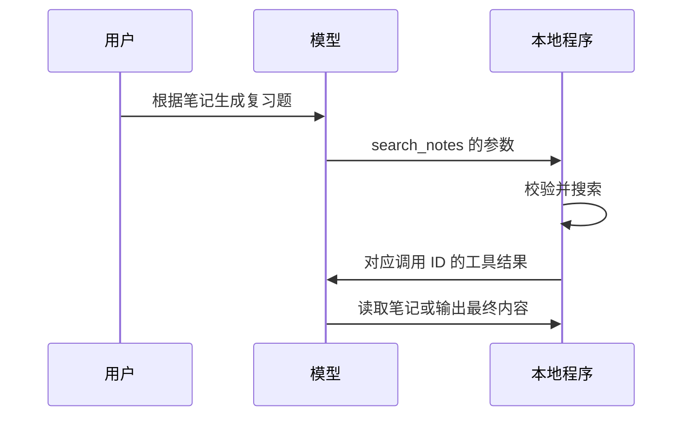

# 工具调用与 Function Calling

[卡片目录](README.md) · [第四阶段课程](../20-课程笔记/第四阶段-工具调用与Agent课程及实践顺序.md)

## 一句话解释

**工具调用是模型提出“用哪个工具、传什么参数”，由程序检查后真正执行，再把结果交回模型。**像填写借书申请，由图书馆系统核对后取书。

## 最小流程

模型返回 `read_note` 的名字，不等于文件已被读取。DeepSeek 示例也明确要求由开发者实现实际函数。[工具调用指南](https://api-docs.deepseek.com/guides/tool_calls/)

## 与普通 JSON 输出的区别

普通 JSON 只是结构化文本；工具调用还包含工具定义、调用 ID、参数与结果回传的协议。应用仍需校验参数，不能把模型文本直接交给 `eval` 或命令行执行。

本项目仅登记 `search_notes` 与 `read_note`，不执行模型生成的 Python，不提供发送消息、删文件或提交 Git 的工具。

## 小练习与自测

- [ ] 找到一条工具调用的名称、参数和调用 ID。
- [ ] 找到对应的本地执行记录与回传结果。

**问题：**模型说“已经读完笔记”，但没有成功读取记录，算完成吗？

**参考要点：**不能仅凭自述判断；检查实际工具结果和最终依据。

## 来源与相关笔记

[DeepSeek Tool Calls](https://api-docs.deepseek.com/guides/tool_calls/)、[HF：什么是工具](https://huggingface.co/learn/agents-course/zh-CN/unit1/tools)。核查：2026-10-23。项目工具是自定义教学接口。

[API](API.md) · [工具描述与参数Schema](工具描述与参数Schema.md) · [工具结果与消息状态](工具结果与消息状态.md)
