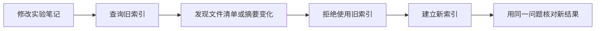

# 索引更新与数据边界

[第三阶段阅读顺序](../20-课程笔记/第三阶段-RAG课程与实践顺序.md) · [项目 03](../30-项目实践/03-RAG知识库问答/README.md)

## 一句话解释

**索引保存的是资料某一时刻的处理结果；数据边界规定哪些材料可以被读取、检索和发送。**笔记变了，需要处理索引与新资料的一致性；接入模型时，还要弄清资料究竟去了哪里。

## 为什么需要它

你已经把 Markdown 中的一条旧建议改正，但检索仍从昨天建立的索引找资料，就可能继续给模型旧内容。删除原笔记，也不代表旧索引、历史回答和备份中的副本自动消失。

另外，文件在本地、GitHub 仓库私有，都不能推导出“调用外部模型时文字仍只在本地”。这几个环节的数据流向需要分别检查。

## 用 MindVault 走一遍

先在实验资料副本里建立索引 v1。假设你把某条演示配置从“旧接口地址”改为“新接口地址”，再用 v1 查询。

当前脚本会重新读取所选目录，计算每份 Markdown 的 SHA-256，与索引中的 `manifest` 比较。出现新增、删除或内容变化时，它会拒绝继续使用 v1。你需要另建 v2，再对同样问题检查结果。

SHA-256 可理解为内容指纹：它帮助发现文件字节发生变化，不能解释变化的含义，也不能证明新内容一定正确。即使只修改了笔记的学习状态，文件内容摘要也会变化。

这是当前教学实现的明确规则。其他系统可能支持自动更新或增量同步，不能假定所有 RAG 系统都有同样的检查。

## 每一步的输入输出

| 步骤 | 输入 | 输出 |
| --- | --- | --- |
| 选择范围 | 允许使用的实验目录 | 本次资料集合 |
| 建立快照 | 文件、切分与模型配置 | 片段、来源与文件摘要 |
| 查询前检查 | 当前文件与旧清单 | 一致，或指出需要重建 |
| 重建 | 新资料和配置 | 新的索引文件 |
| 回归核对 | 相同问题与新索引 | 新答案依据、成功或失败记录 |

本项目采用全量重建：重新处理全部选定资料。增量更新则尝试只处理变化的部分，但还要正确移除旧片段、处理删除文件、保持 ID 与元数据对应，不能只把新向量不断追加进去。

## 你的资料会去哪儿

| 操作 | 当前项目的数据流向 |
| --- | --- |
| 默认关键词建库、检索、摘录 | Python 在本地读取显式选择的 Markdown 目录 |
| 语义检索选修 | 需要下载依赖或模型；本文所用编码路径在本机计算文本向量，不调用云端 Embedding API |
| preview | 在本地展示即将发送的请求，输出里可能包含私人原文 |
| live 问答 | 将问题与本次选中片段发送给 DeepSeek；当前实现不是上传整个知识库 |
| GitHub 提交 | 上传实际被暂存并推送的文件；本项目默认忽略 `.local/` |

这张表依据本库现有代码，不代表其他插件、框架或模型服务都遵守相同路径。换工具或配置后要重新检查。

## 常见疑问

**能直接把整个 MindVault 当资料目录吗？** 初学先选少量允许用于实验的笔记，复制到专用目录。全库可能包括私人信息、未整理草稿或不适合发送的材料，也容易超出教学脚本限制。

**标记“仅自己可见”能自动隔离吗？** 属性本身只是数据。当前项目没有多用户权限系统，也不会自动根据标签实现权限过滤；需要由应用在读取、检索和发送之前执行对应规则。

**索引被 Git 忽略，就一定不会上传吗？** `.gitignore` 主要约束未跟踪文件的正常添加。已跟踪文件或强制添加需要另查，因此提交前仍应看暂存清单。

**删掉索引能撤回之前发给外部服务的文字吗？** 本地删除只影响本地副本，无法自动撤回已发送的请求。外部服务如何保留和处理数据，需要另外核对其规则。

**只换 Embedding 模型，需要重建吗？** 通常需要重新编码文档，确保查询与资料向量兼容。即使 Markdown 没变，也不能随意混用不同模型的结果。

## 小练习与自测

假设你只在一篇实验笔记里多加了一个空格，旧索引是否仍可用？若文件名完全没变，为什么还要检查摘要？

参考答案：当前脚本比较原始文件字节的摘要，空格变化也会触发不一致；文件名相同不能证明内容没有变化。

### 动手记录

- [ ] 在本地副本修改一行，观察旧索引被拒绝，重建后再检索。
- [ ] 增加、删除文件各一次，记录重建原因。
- [ ] 提交前确认 `.local/` 与密钥没有进入 Git 暂存区。

## 本库实现与实践入口

按[实践三](../30-项目实践/03-RAG知识库问答/实践三-语义检索与索引更新.md)在自己的实验副本中修改、增加和删除资料，观察旧索引拒用，并以新文件名重建。保留原始学习笔记和每次实验的配置记录。

此处讲解索引生命周期与数据流向，没有替你把整个知识库建索引，也没有触发外部模型调用。

## 来源与延伸阅读

核查于 2026-10-29：[LlamaIndex 文档管理](https://developers.llamaindex.ai/python/framework/module_guides/indexing/document_management/)用于核对插入、更新、删除与刷新这一类需求。哈希检查、全量重建与发送范围依据本库 [rag_practice.py](../30-项目实践/03-RAG知识库问答/rag_practice.py)；Git 忽略规则以本库配置为准。

## 相关笔记与下一步

上一张：[RAG 评估与故障定位](RAG评估与故障定位.md)。回到[第三阶段课程](../20-课程笔记/第三阶段-RAG课程与实践顺序.md)，选一项实践并留下自己的记录。[向量索引与向量数据库](向量索引与向量数据库.md)解释索引保存什么，[API 密钥与环境变量](API密钥与环境变量.md)补充配置方式。
