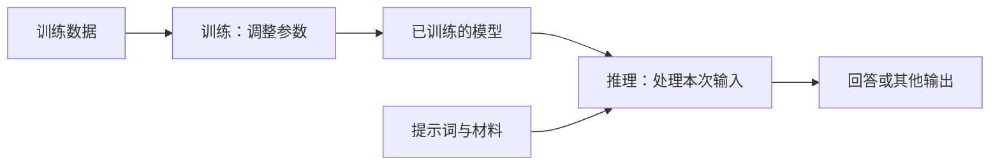

# 训练与推理

[知识卡片目录](README.md) · [学习地图](../学习地图.md)

## 一句话解释

**训练是在数据上调整模型参数；推理是使用已经训练好的模型处理输入、得到输出。**对大语言模型来说，使用模型根据提示生成回答属于推理。[定义依据：Google training](https://developers.google.com/machine-learning/glossary#training)、[inference](https://developers.google.com/machine-learning/glossary#inference)

## 用生活里的事理解

用学做菜作类比：练习并根据反馈改进，好比训练；用已经掌握的方法做一顿饭，好比推理。

类比帮助区分阶段，模型是否在训练，仍要看实际有没有调整内部 [参数](参数.md)。

## 两个过程放在一起看

这是自拟的入门示意图，省略了评估、保存模型和服务部署等环节。

| 对比 | 训练 | 常规推理 |
| --- | --- | --- |
| 主要目的 | 从数据中学习或调整能力 | 使用现有模型完成一次任务 |
| 参数变化 | 根据训练过程更新 | 使用已训练的参数，通常不更新 |
| 可能的结果 | 更新后的模型状态 | 一份预测、回答或其他输出 |

PyTorch 官方入门示例把优化参数与加载模型后进行预测分开演示，后续深入时可以对照阅读。[流程依据：PyTorch Quickstart](https://docs.pytorch.org/tutorials/beginner/basics/quickstart_tutorial.html)

## 一个具体例子

**自拟的 MindVault 场景：**

- 给模型一篇文章，让它生成摘要：在使用模型推理。
- 先找出相关笔记，再让模型回答：提供资料并推理，检索步骤本身不等于训练。
- 收集一组样本，用训练程序更新模型权重：涉及训练，具体方法要在微调阶段学习。

## 容易误解的地方

- 机器学习里说的“推理”，范围比日常说的逻辑推理更广；生成一句摘要也属于模型推理。
- “回答时用了新资料”不等于“这些资料已经写进了模型参数”。
- 应用保存聊天或笔记是存储功能。以后能检索回来使用，还需要相应的读取流程。

## 放到 MindVault 中有什么用

当前学习文章整理、笔记问答和模型调用，主要是在应用模型。理解训练与推理的区别，有助于判断一个功能需要读取资料、调整提示，还是确实要进一步研究微调。

## 我的理解与验证

- [ ] 画出一次文章整理任务的输入、模型和输出。
- [ ] 在自己的流程图中标出：哪些是文件读取，哪一步是模型推理。
- [ ] 阅读后用一句话回答：“提供一本书给模型总结，为什么通常不等于训练？”

## 自测与参考答案

**问题：**把三篇笔记放进一次 API 请求，让模型据此出题，属于训练还是推理？

**参考要点：**在常规调用中属于推理；这三篇笔记是本次上下文。仅提供这些输入，不等于执行了权重更新。

## 来源

- [Google：training](https://developers.google.com/machine-learning/glossary#training)、[inference](https://developers.google.com/machine-learning/glossary#inference)，用于术语定义。
- [PyTorch：Quickstart](https://docs.pytorch.org/tutorials/beginner/basics/quickstart_tutorial.html)，用于参数优化和模型预测的流程对照。
- 来源核查日期：2026-10-23。做菜类比、流程图和 MindVault 场景为自拟，并非已执行的训练实验。

## 相关笔记

[大模型](大模型.md) · [参数](参数.md) · [提示词](提示词.md) · [上下文](上下文.md) · [API](API.md)

## 仍有疑问

- [ ] 什么情况下值得微调，而不只调整输入资料？在具体项目中再比较。
